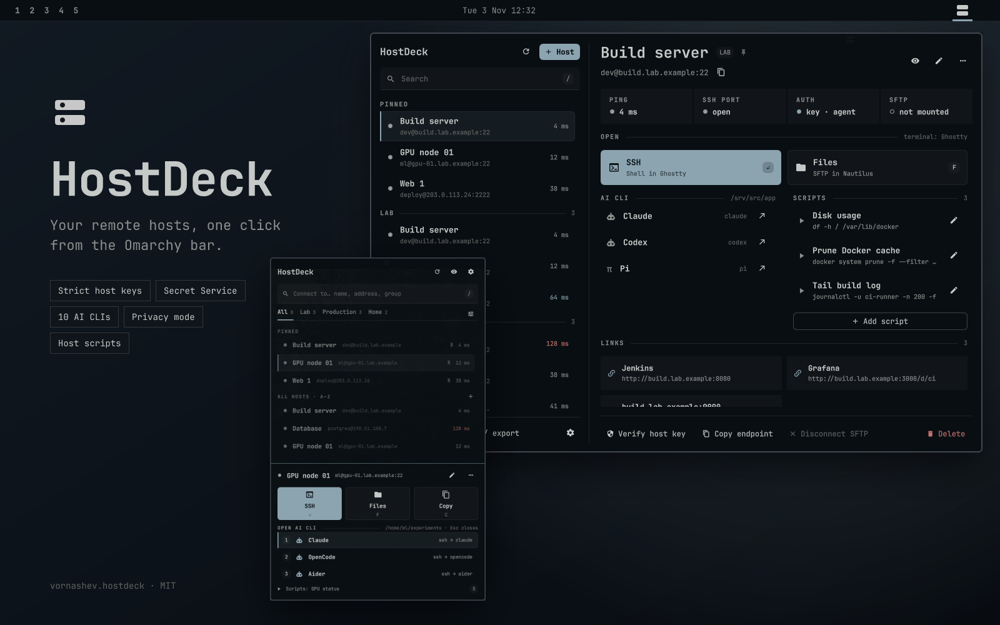
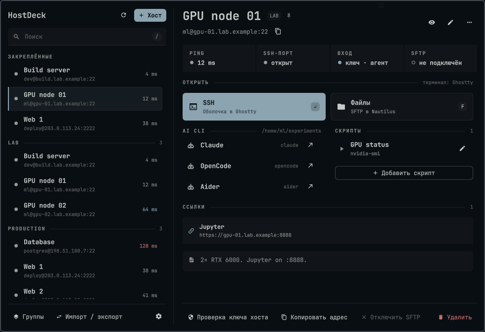
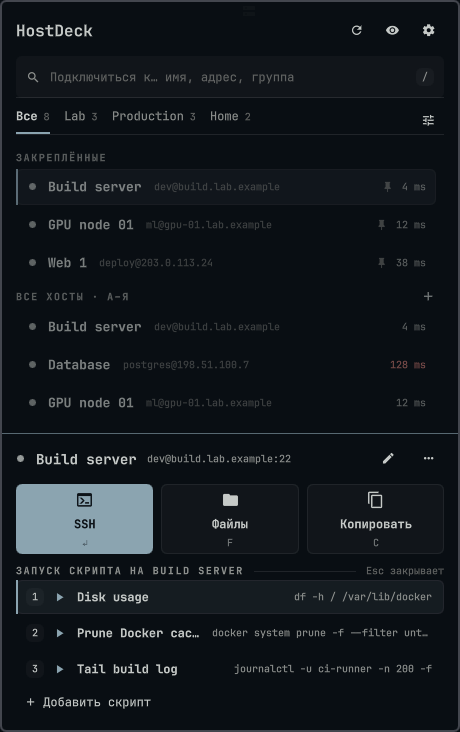
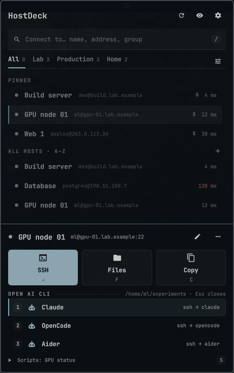
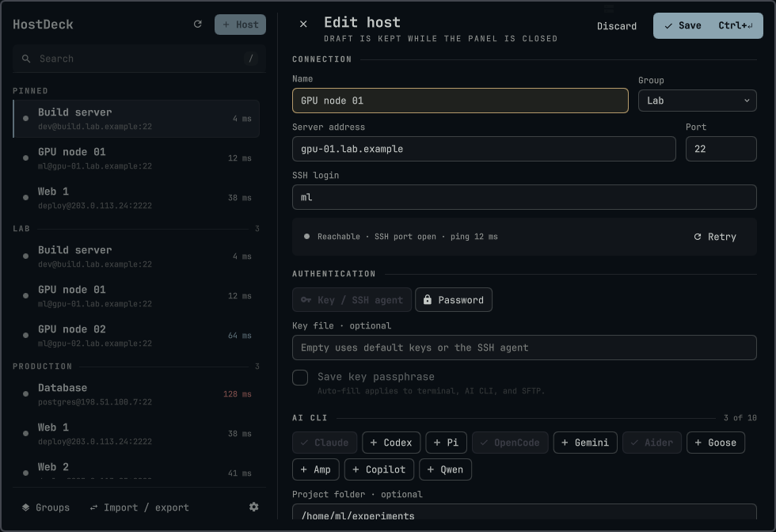
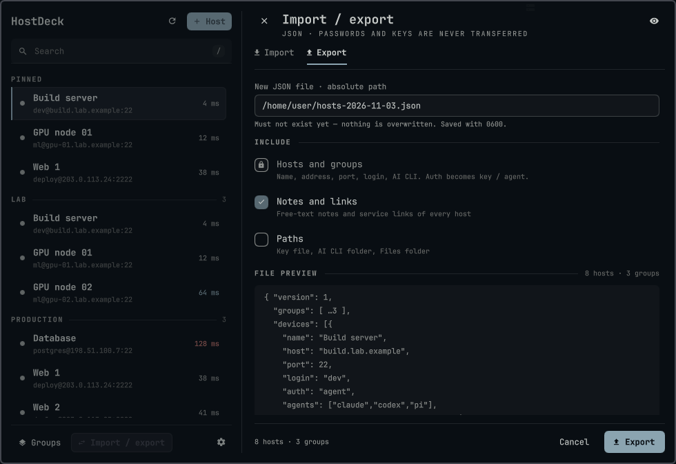
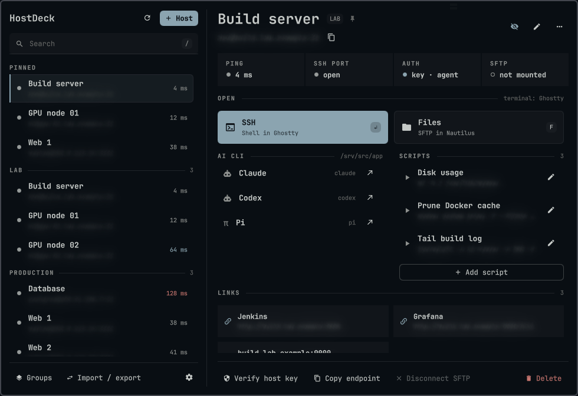

# HostDeck для Omarchy

[English](README.md) · Русский



HostDeck — плагин для бара Omarchy: каталог удалённых хостов с SSH, SFTP,
строгой проверкой host key, запуском интерактивных AI CLI, скриптами хостов и
ссылками на сервисы в одной нативной панели QML/Quickshell.

Идентификатор плагина: `vornashev.hostdeck` · Лицензия: [MIT](LICENSE)

## Установка

```bash
omarchy plugin add https://github.com/vornashev/omarchy-hostdeck --enable
omarchy bar move vornashev.hostdeck --section right   # необязательно
```

Нажмите на иконку в баре, чтобы открыть панель, затем **+ Хост**, чтобы добавить
хост.

| Задача | Команда |
| --- | --- |
| Обновить | `omarchy plugin update vornashev.hostdeck` |
| Удалить | `omarchy plugin remove vornashev.hostdeck` (данные остаются, см. [Удаление](#удаление)) |

Плагин не устанавливает пакеты, не запускает install-хуки и не меняет
`~/.ssh/config`. В `~/.ssh/known_hosts` он пишет только после явного доверия
проверенному host key.

**Переход с Remote Hosts.** В версии 0.8 плагин Remote Hosts
(`vornashev.remote-hosts`) переименован в HostDeck. Выполните
`omarchy plugin remove vornashev.remote-hosts` и установите HostDeck, как
показано выше; данные и сохранённые секреты перейдут в новый namespace при
первом запуске.

### Зависимости

| | Для чего |
| --- | --- |
| Omarchy Shell / Quickshell, Python 3 (только стандартная библиотека) | Сам плагин |
| `ssh`, `ssh-keyscan`, `ssh-keygen` (клиент OpenSSH) | Подключения и проверка host key |
| Ghostty, Kitty, Alacritty или foot | Терминалы для SSH, AI CLI и скриптов |
| `secret-tool` и разблокируемый Secret Service (необязательно) | Сохранённые пароли и парольные фразы ключей |
| `sshfs`, FUSE 3, Nautilus (необязательно) | SFTP |
| `wl-copy` (необязательно) | Копирование SSH-адресов и URL ссылок |

AI CLI должны быть заранее установлены и авторизованы в `PATH` login shell
удалённого пользователя. Плагин не устанавливает программы на сервер.

## Содержание

- [Возможности](#возможности)
- [Скриншоты](#скриншоты)
- [Использование](#использование): [панель и клавиатура](#панель-и-клавиатура),
  [иконка в баре](#иконка-в-баре), [ссылки на сервисы](#ссылки-на-сервисы),
  [скрипты хоста](#скрипты-хоста), [настройки](#настройки),
  [приватность при демонстрации экрана](#приватность-при-демонстрации-экрана)
- [Безопасность и данные](#безопасность-и-данные):
  [модель безопасности](#модель-безопасности),
  [секреты аутентификации](#секреты-аутентификации),
  [хранение и обновление](#хранение-и-обновление)
- [Удаление](#удаление)
- [Разработка](#разработка)

## Возможности

- **Каталог хостов:** группы, закрепление, заметки, ссылки на сервисы и до 100
  хостов. Поиск по имени, адресу, группе, заметке и ссылкам; Enter подключает к
  лучшему совпадению.
- **Две раскладки:** узкая — список и панель действий снизу, широкая — список и
  подробности хоста справа. **Авто** включает широкую, если на экране для панели
  остаётся не меньше 760 px.
- **Статус с первого взгляда:** проверка ping и SSH-порта идёт по хостам с
  полосой прогресса. Задержка окрашивается только цветами темы: нейтральный до
  50 мс, акцентный от 51 до 99 мс, urgent от 100 мс.
- **Подключение:** SSH в Ghostty, Kitty, Alacritty или foot; SFTP через SSHFS с
  открытием в Nautilus.
- **AI CLI:** выбор интерактивных агентов и необязательной рабочей папки для
  каждого хоста (см. таблицу ниже).
- **Скрипты хоста:** явно сохранённые скрипты для каждого хоста, запуск в
  терминале по SSH по нажатию.
- **Импорт и экспорт:** JSON без паролей и признаков наличия сохранённого
  секрета. Предпросмотр импорта показывает каждый входящий хост как новый,
  обновлённый или пропущенный; экспорт показывает образец файла для выбранных
  опций. Закрепление не экспортируется, а импорт с заменой сохраняет локальное.
- **Секреты:** серверные пароли и выбранные парольные фразы SSH-ключей хранятся
  только в Secret Service.
- **Режим приватности** для демонстрации экрана; интерфейс на английском или
  русском.

| Агент | Команда на сервере |
| --- | --- |
| Pi | `pi` |
| Codex | `codex` |
| Claude | `claude` |
| OpenCode | `opencode` |
| Gemini CLI | `gemini` |
| Aider | `aider` |
| Goose | `goose session` |
| Amp | `amp` |
| GitHub Copilot CLI | `copilot` |
| Qwen Code | `qwen` |

Команды и аргумент `session` для Goose зафиксированы в backend. Плагин не
принимает произвольные executable, аргументы, shell-фрагменты или флаги
автоматического разрешения действий для запуска AI CLI. Пользовательские
скрипты — отдельная функция удалённого выполнения: проверяйте их перед запуском.

## Скриншоты

На всех скриншотах — синтетические хосты и адреса из документационных диапазонов.



| Узкая раскладка: скрипты | Узкая раскладка: AI CLI |
| --- | --- |
|  |  |

| Редактор хоста | Импорт и экспорт |
| --- | --- |
|  |  |



## Использование

### Панель и клавиатура

При открытии фокус стоит на списке хостов, а выбранный ранее хост
восстанавливается, поэтому клавиши действий работают сразу. Любой другой символ
или `/` переводит в поиск; Esc в пустом поле поиска возвращает к списку. Хост
выбирается щелчком или ↑↓; панель действий (узкая раскладка) или подробности
(широкая) следуют за выбором. Наведение мыши и курсор клавиатуры подсвечиваются
одинаково.

| Клавиша | Действие |
| --- | --- |
| `/` | Перейти к поиску |
| ↑ ↓ | Переместить выбор |
| Tab | Следующая вкладка группы (узкая) или переход между списком и подробностями (широкая) |
| Enter | SSH к выбранному хосту или лучшему совпадению поиска |
| Пробел / `P` | Закрепить или открепить |
| `F` / `C` | Файлы (SFTP), копировать SSH-адрес |
| `A` / `S` / `L` | AI CLI, скрипты или ссылки: список в панели действий, где `1`–`9` запускают (узкая), или курсор переходит к этому разделу подробностей (широкая) |
| `C` на ссылке (широкая) | Копировать URL этой ссылки вместо SSH-адреса |
| `E` / `K` / `R` / Del | Изменить, проверить ключ хоста, повторить проверку, удалить |
| Ctrl+Enter | Сохранить форму хоста |
| Esc | Закрыть выбор или подтверждение, очистить поиск, выйти из поиска, затем закрыть панель |

Правый щелчок по хосту открывает контекстное меню, двойной — подключает.
Удаление хоста и пустой группы подтверждается прямо на месте. Если для запуска
нужен ключ хоста, появляется уведомление с действием **Проверить** (`K`),
которое открывает сверку fingerprint; после подтверждения запуск продолжается.
Закрепление сохраняется в профиле, а вкладки групп, свёрнутые группы и выбор —
только состояние вида.

Копируемый SSH-адрес — `логин@хост`, для нестандартного порта добавляется
` -p порт`.

### Иконка в баре

Иконка занимает прежний слот 27 px и показывает один сигнал за раз, по
приоритету: закреплённый хост недоступен (красный бейдж), идёт проверка
(иконка приглушена, нижняя плашка пульсирует), смонтирован SFTP (нижняя плашка
тусклее), включено скрытие адресов (сплошные плашки), иначе — обычная иконка.

| Ввод | Действие |
| --- | --- |
| ЛКМ | Открыть или закрыть панель |
| СКМ | Проверить все хосты (ping и SSH-порт) |
| ПКМ | Быстрое меню: до пяти закреплённых хостов (подключение по SSH), проверить все, отключить смонтированные SFTP, скрыть или показать адреса, открыть панель |
| Наведение | Сводка: число хостов и закреплённых, недоступные закреплённые, активные SFTP, время проверки |
| Колесо | Листать закреплённые хосты в подсказке; прокрутка ничего не запускает |

Подсказка и быстрое меню показывают только имена хостов, без `user@host`.
Подключение из меню идёт тем же путём, что и из панели: строгая проверка
ключа хоста и askpass; если запуск не удался или нужен ключ хоста, открывается
панель с уведомлением. Escape или щелчок мимо закрывают меню.

Каталог читается из локальных файлов при запуске оболочки, поэтому иконка и
подсказка работают до первого открытия панели; к хостам никто не обращается до
проверки. **Настройки → Проверять закреплённые** по желанию перепроверяет
закреплённые хосты каждые 5, 15, 30 или 60 минут (по умолчанию выключено).

### Ссылки на сервисы

У каждого хоста может быть до 16 ссылок на развёрнутые на нём сервисы:
дашборды, админки, API. Добавьте их в разделе **Ссылки** редактора хоста;
**Добавить ссылку** подставляет `http://<адрес хоста>:`, так что остаётся
дописать порт и путь. Название необязательно: без него показываются хост и
порт из URL.

- **Широкая раскладка:** ссылки показаны карточками в подробностях. Клик
  открывает URL в браузере по умолчанию через `xdg-open`, а кнопка
  копирования, появляющаяся при наведении, копирует его через `wl-copy`.
- **Узкая раскладка:** чип **Ссылки** или `L` открывает список, где `1`–`9`
  открывают ссылку.

Принимаются только URL `http://` и `https://` без пробелов и управляющих
символов. URL с логином или паролем (`user:pass@host`) отклоняются, потому что
ссылки показываются и копируются как есть. Ссылки экспортируются вместе с
заметками; не храните токены в URL, который собираетесь экспортировать.

### Скрипты хоста

**Добавление.** Выберите хост и нажмите **Добавить скрипт** в списке его
скриптов, затем введите текст или выберите локальный исполняемый `.sh` в
домашнем каталоге. Файл должен принадлежать вам, не быть symlink, содержать
UTF-8, быть не больше 16 КиБ и не разрешать запись другим пользователям.

**Хранение.**

- Плагин сохраняет приватную **копию** в `scripts.json` (0600); изменение
  исходного файла не меняет сохранённый скрипт. Выбор другого `.sh` заменяет
  копию; переименование не перечитывает исходный файл.
- Общий лимит — 32 скрипта. Скрипты остаются на этой машине и не входят в
  импорт/экспорт хостов.
- Скрипты из файлов открываются только для чтения и помнят исходный путь;
  введённые вручную остаются редактируемыми. У скриптов, сохранённых до
  появления файловых источников, содержимое видно, но исходный путь
  восстановить невозможно.
- В списке для каждого скрипта видна только первая командная строка (без
  shebang и комментариев, не длиннее 120 символов); редактор загружает полную
  сохранённую копию по локальному каналу предпросмотра.
- Окно выбора файлов запоминает последний открытый каталог после перезапуска
  shell в приватном `script-browser.json` (0600); если каталог исчез,
  откроется домашняя папка. Этот путь не экспортируется.
- Изменение адреса, порта либо логина хоста блокирует старые скрипты; удаление
  хоста удаляет их.

**Запуск.** Нажмите на скрипт или выберите его через `S`, затем номер (узкая
панель действий) или Enter (широкие подробности). Откроется терминал, и скрипт
выполнится на хосте через SSH с `sh -s` или `bash -s` по поддерживаемому
shebang (`#!/bin/sh`, `#!/usr/bin/env sh`, `#!/bin/bash`, `#!/usr/bin/env bash`).
Текст передаётся по stdin, а не в аргументах командной строки или переменных
окружения. Требуются проверенный host key и строгая проверка ключа. Скрипт не
остаётся файлом на удалённом хосте. Терминал показывает результат; при закрытии
или потере соединения выполнение может прерваться.

Это намеренный запуск пользовательского кода на сервере: не включайте в скрипты
пароли, токены или приватные ключи.

### Настройки

Откройте каталог и выберите **Settings / Настройки**:

- **Language / Язык:** English или Русский. Для новой установки выбран English.
- **Panel layout / Раскладка панели:** Авто, Компактная (узкая) или Широкая.
- **Check pinned hosts / Проверять закреплённые:** счётчик − / + по значениям
  Выкл., 5, 15, 30 и 60 минут.
- **Default terminal / Терминал по умолчанию:** Ghostty, Kitty, Alacritty или foot.

Терминал используется новыми окнами SSH и AI CLI для всех хостов. Не
установленный терминал выбрать можно, но он блокирует **Сохранить**;
автоматического fallback нет. SFTP остаётся отдельным действием. Все настройки
локальны для машины, применяются после **Сохранить** и не входят в импорт или
экспорт профилей.

### Приватность при демонстрации экрана

Кнопка-глаз в заголовке панели размывает логины и адреса в строках хостов,
панели действий и подробностях, URL ссылок, редакторе, уведомлениях,
предпросмотре скриптов, импорта и экспорта, а также при проверке host key. Пока
режим включён, поля endpoint и URL ссылок нельзя редактировать, а доверие
новому host key нельзя подтвердить до повторного показа адресов.

Это временный визуальный режим для демонстрации экрана, а не криптографическое
сокрытие. Он не меняет сохранённые профили и настоящий endpoint, копируемый из
панели, и не скрывает буфер обмена, внешние терминалы или адресоподобный текст
в произвольных названиях и заметках. Режим общий для экземпляров панели до
перезапуска процесса shell и не сохраняется на диск.

## Безопасность и данные

### Модель безопасности

- Пароли и парольные фразы ключей не попадают в argv, переменные окружения,
  JSON профилей, логи, буфер обмена и ответы helper. Не добавляйте секреты
  в скрипты.
- Секрет передаётся только через stdin/pipe минимального askpass. Askpass
  принимает исключительно точный запрос OpenSSH, привязанный к endpoint
  профиля, а для фразы — и к точному пути настроенного ключа.
- SSH использует фиксированные argv и `-F /dev/null`; local commands и
  forwarding отключены.
- Для входа по паролю и передачи сохранённой фразы обязателен
  `StrictHostKeyChecking=yes`; во втором случае также запрещены парольная и
  keyboard-interactive аутентификация.
- Новый host key требует просмотра SHA256 fingerprint и явного доверия.
- Конфликтующие, изменённые, revoked и certificate-authority записи не
  заменяются.
- Плагин не читает содержимое приватных ключей.
- Импортированные профили не заявляют наличие пароля или парольной фразы ключа.
- Служебные файлы, mount, владелец, права, symlink и размеры файлов проверяются
  перед использованием.

`ssh-keyscan` не доказывает подлинность сервера. Сверяйте каждый fingerprint по
независимому доверенному каналу.

### Секреты аутентификации

Для профиля с паролем серверный пароль хранится в Secret Service. Для профиля
«Ключ / SSH-агент» можно указать абсолютный путь к приватному ключу и включить
**Сохранять парольную фразу ключа**. Фраза хранится в отдельном namespace Secret
Service; в профиль попадают только флаг настройки и путь к ключу.

- При первом сохранении, включении опции или смене адреса, порта, логина либо
  пути к ключу фразу нужно ввести заново. Пустое поле сохраняет прежнюю фразу
  только при неизменной привязке.
- Выключение опции или удаление хоста очищает соответствующую фразу после
  безопасной публикации изменения профиля.
- Сохранённая фраза передаётся только SSH в терминале, SSH для AI CLI и SFTP.
- При экспорте флаг всегда сбрасывается; новые импортированные хосты получают
  выключенную опцию, а импорт с заменой сохраняет локальные способ входа, путь
  к ключу и флаг.

### Хранение и обновление

Профили и глобальные настройки находятся в:

```text
$XDG_DATA_HOME/vornashev.hostdeck/
```

Путь по умолчанию — `~/.local/share/vornashev.hostdeck/`. Каталог имеет права
0700, файлы данных и lock — 0600. Запись использует временный файл в том же
каталоге, `fsync` и атомарную замену.

При первом запуске версия 0.8 безопасно перемещает приватный каталог данных из
предыдущего namespace (`vornashev.remote-hosts` или более старого), если новый
каталог ещё не существует. Небезопасные права и symlink приводят к отказу.
Пароли и парольные фразы SSH-ключей переносятся из прежних атрибутов
application Secret Service при первом чтении, после чего найденная старая запись
удаляется.

Схема профилей остаётся версией 1:

```text
{version, groups, devices}
```

У хоста может быть необязательное логическое поле `pinned`; старые профили без
него загружаются без изменений. Неизвестные и секретные поля, повторяющиеся
JSON-ключи, некорректные связи групп и повтор endpoint отклоняются.

## Удаление

```bash
omarchy plugin remove vornashev.hostdeck
```

Удаление плагина не трогает профили, скрипты и настройки в
[каталоге данных](#хранение-и-обновление), поэтому после повторной установки
они вернутся. Для полной очистки:

1. Отключите активные SFTP-монтирования (правый клик по иконке → отключить).
2. Удалите в панели хосты с сохранённым паролем или парольной фразой ключа:
   удаление хоста очищает его записи в Secret Service.
3. Удалите плагин, затем каталог данных:
   `rm -rf -- "${XDG_DATA_HOME:-$HOME/.local/share}/vornashev.hostdeck"`.

Доверенные host key остаются в `~/.ssh/known_hosts`, как и ключи, принятые
самим `ssh`.

## Разработка

```bash
git clone https://github.com/vornashev/omarchy-hostdeck.git
cd omarchy-hostdeck

PYTHONDONTWRITEBYTECODE=1 python3 -B -m unittest discover -s tests
omarchy plugin validate "$PWD"
scripts/qml-lint
scripts/deploy-local
omarchy plugin enable vornashev.hostdeck   # только в первый раз
```

`scripts/deploy-local` валидирует исходники и заменяет
`~/.config/omarchy/plugins/vornashev.hostdeck` файлами, которые отслеживает
(или отслеживал бы) git, без `AGENTS.md`, `docs/`, `preview.png`, `scripts/` и
`tests/`. Затем ставит executable bit для askpass, перезапускает shell и ждёт
ответа. Скрипт не устанавливает пакеты и не меняет `~/.ssh/config`.

Тесты используют синтетические endpoint, временные каталоги и поддельные внешние
программы. Они не подключаются к реальным хостам и не читают реальные
credentials, ключи, mount, профили или `known_hosts`.

## Лицензия

[MIT](LICENSE) © 2026 vornashev.
